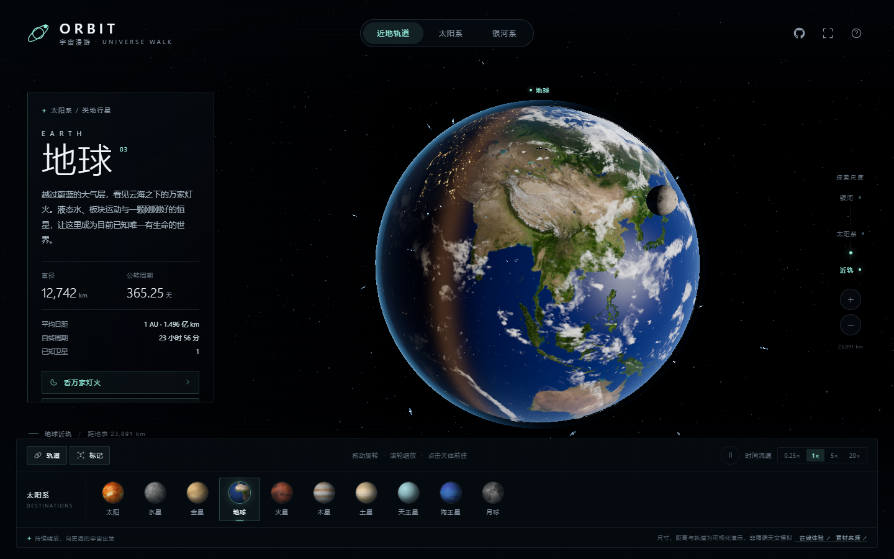

# ORBIT · 宇宙漫游

从近地轨道出发，经过太阳系，抵达银河系。

源码：<https://github.com/jylai0726/earth-web>

在线体验：<https://jylai0726.github.io/earth-web/>

一个使用 Three.js 制作的三维宇宙探索页面：真实天体纹理、连续的多尺度镜头、可交互的太阳系与程序生成的银河。构建后的 `index.html` 已内嵌全部脚本与纹理，**双击即可离线运行**，不需要服务器、CDN 或任何网络请求。



## 体验

- **地球**：昼夜交界、夜间城市灯光、独立云层与大气边缘散射；近景可看万家灯火。
- **近地空间**：24 颗在轨卫星、简化的国际空间站与月球，均可近距离探访。
- **太阳系**：太阳与八大行星、椭圆轨道、土星透明环，天体按真实纹理着色。
- **银河系**：程序生成的四条旋臂、核球、暗尘带与疏密变化，并标出太阳系的位置。
- 点击任意天体、标记或底部目的地，镜头以缓入缓出的连续飞行抵达；拖动或滚轮可随时接管。
- 从地球持续缩小会依次进入太阳系与银河尺度；持续放大可回到当前追踪的天体。
- 支持暂停、`0.25× / 1× / 5× / 20×` 时间流速、轨道与标记开关、全屏、隐藏界面。

## 操作

| 操作 | 方式 |
| --- | --- |
| 旋转视角 | 鼠标拖动 / 单指拖动 |
| 放大缩小 | 滚轮 / 双指捏合 / 右侧 `+` `−` |
| 飞向天体 | 点击天体、屏幕标记或底部目的地 |
| 看万家灯火 | 地球资料面板中的入口，飞向夜面 |
| 探访空间站 | 地球资料面板中的入口，飞到国际空间站 |
| 全屏 | 右上角按钮或 `F` |
| 隐藏界面 | `I`，再次按下恢复 |

### 快捷键

| 键 | 功能 |
| --- | --- |
| `+` / `-` | 放大 / 缩小 |
| `空格` | 暂停 / 继续天体运动 |
| `H` | 回到地球 |
| `F` | 全屏 |
| `I` | 隐藏 / 恢复界面 |
| `?` | 打开操作说明 |

## 本地运行

1. 双击项目根目录的 `index.html`。
2. 或者启动一个静态服务器：

```bash
npx serve .
# 打开 http://localhost:3000
```

建议使用支持 WebGL 2、已开启硬件加速的新版 Chrome、Edge 或 Safari。

## 重新构建

源码位于 `src/`，纹理位于 `assets/`。构建脚本会把 Three.js、场景代码、样式与全部纹理压缩进单个 HTML。

```bash
npm install
npm run build
```

产物写入根目录的 `index.html`，体积约 9 MB（其中纹理约 6 MB）。构建过程不访问网络。

## 项目结构

```text
src/
  shell.html      页面骨架与界面文案
  style.css       深色界面、响应式布局
  universe.js     入口：渲染管线、镜头、拾取、主循环
  world.js        太阳、行星、地球、卫星、空间站、银河
  nav.js          球面轨道镜头、连续飞行、缩放与尺度切换
  labels.js       三维标记的投影、遮挡与碰撞
  ui.js           资料面板、目的地、图层与时间控制
  textures.js     纹理加载、缩略图与程序化光晕
  data.js         天体目录与演示参数
  config.js       线上体验 / GitHub 地址、泛光与像素比
assets/           原始纹理与素材来源
build.mjs         单文件构建脚本
index.html        构建产物
```

## 配置

编辑 `src/config.js`：

```js
export const CONFIG = {
  siteUrl: 'https://ryh842487118-bot.github.io/orbit/',
  repoUrl: 'https://github.com/ryh842487118-bot/orbit',
  maxPixelRatio: 1.75,
  mobilePixelRatio: 1.35,
  bloomStrength: 0.62,
  bloomRadius: 0.45,
  bloomThreshold: 0.82,
};
```

也可以在 `index.html` 中、主脚本之前加入 `window.ORBIT_CONFIG = { repoUrl: '...' }` 覆盖其中任意字段。右上角 GitHub 按钮与页脚「在线体验」都使用这里的地址，并在新标签页打开。

浏览器控制台提供一个轻量接口，便于调试：

```js
ORBIT.goTo('saturn');       // 飞向土星
ORBIT.goTo('earth', { instant: true });
ORBIT.goView('galaxy');     // 银河尺度
ORBIT.setPaused(true);
ORBIT.getState();
```

## 素材与许可

- 天体纹理：**Solar System Scope**，<https://www.solarsystemscope.com/textures/>，按 [CC BY 4.0](https://creativecommons.org/licenses/by/4.0/) 使用。纹理在构建时按显示需要缩放并内嵌。
- 三维引擎：**Three.js**（MIT）。
- 界面语言、项目结构与素材整理参考了开源项目 **ORBIT**：<https://github.com/ryh842487118-bot/orbit>（Apache-2.0）。本项目为独立复刻实现，代码按 MIT 许可发布。

完整清单见 [`assets/CREDITS.md`](assets/CREDITS.md) 与 [`NOTICE`](NOTICE)。

## 说明与限制

- 这是交互可视化，不是精确天文模拟。天体半径、轨道半径、运行周期与自转速度均经过视觉调整；真实比例下行星在屏幕上会小于一个像素。
- 银河系为程序生成的示意模型，旋臂数量、颜色与太阳位置仅用于表达尺度，不用于导航或天文测量。
- 卫星、国际空间站采用展示比例，轨道倾角与高度为示意。
- 地球、月球与行星使用 2K 纹理（移动端部分降至 1K），极近距离下地表细节有限。
- 页面不包含广告、访问统计或任何外部上报请求。

## License

代码以 [MIT](LICENSE) 发布；第三方纹理与库遵循各自的许可证，见 [`assets/CREDITS.md`](assets/CREDITS.md)。
