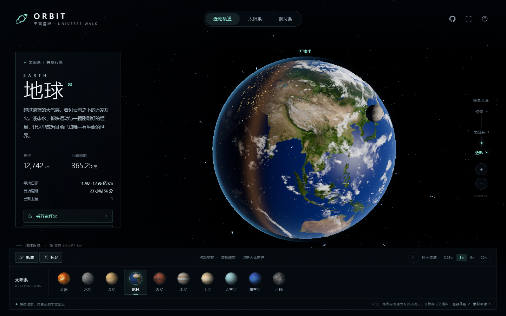

# ORBIT · Universe Walk

Leave Earth's orbit, cross the solar system, and keep going until the Milky Way comes into view.

Source: <https://github.com/jylai0726/earth-web>

A Three.js space exploration page with real planetary textures, a continuous multi-scale camera, an interactive solar system and a procedurally generated galaxy. The built `index.html` embeds every script and texture, so it runs **offline by double-clicking**, with no server, CDN or network request.



## What you can explore

- **Earth** — day/night terminator, city lights, a separate cloud layer and atmospheric limb scattering. A dedicated entry flies to the night side.
- **Near-Earth space** — 24 satellites, a simplified International Space Station and the Moon, all reachable up close.
- **Solar system** — the Sun and eight planets with real textures, orbit rings and Saturn's translucent rings.
- **Milky Way** — a procedural four-arm spiral with a bright bulge, dust lanes and density variation, including a marker for the solar system.
- Click any body, on-screen label or destination to fly there with a continuous eased camera move. Drag or scroll at any time to take over.
- Keep zooming out to move from Earth's orbit to the solar system and then to galactic scale; zoom in to return to the tracked body.
- Pause, `0.25× / 1× / 5× / 20×` time, orbit and label toggles, fullscreen and a UI-free mode.

## Controls

| Action | Input |
| --- | --- |
| Orbit the camera | Drag with the mouse / one finger |
| Zoom | Wheel / pinch / `+` `−` |
| Fly to a body | Click a body, a label, or a destination |
| Night side | “看万家灯火” in Earth's info panel |
| Visit the ISS | “探访空间站” in Earth's info panel |
| Fullscreen | Top-right button or `F` |
| Hide the interface | `I`, press again to restore |

### Keyboard

| Key | Action |
| --- | --- |
| `+` / `-` | Zoom in / out |
| `Space` | Pause / resume |
| `H` | Back to Earth |
| `F` | Fullscreen |
| `I` | Toggle the interface |
| `?` | Help |

## Run locally

1. Double-click `index.html` in the project root.
2. Or serve the folder:

```bash
npx serve .
# open http://localhost:3000
```

A recent Chrome, Edge or Safari with WebGL 2 and hardware acceleration is recommended.

## Rebuild

Sources live in `src/`, textures in `assets/`. The build inlines Three.js, the scene code, the stylesheet and every texture into one HTML file.

```bash
npm install
npm run build
```

The result is `index.html` (about 9 MB, with roughly 6 MB of textures). The build makes no network requests.

## Structure

```text
src/
  shell.html      page skeleton and interface copy
  style.css       dark UI and responsive layout
  universe.js     entry: render pipeline, camera, picking, main loop
  world.js        Sun, planets, Earth, satellites, ISS, galaxy
  nav.js          spherical camera rig, flight animation, scale hand-off
  labels.js       label projection, occlusion and collision
  ui.js           info panel, destinations, layers, time controls
  textures.js     texture loading, thumbnails, procedural glows
  data.js         body catalog and visual parameters
  config.js       site / repository URLs, bloom and pixel ratio
assets/           original textures and credits
build.mjs         single-file build script
index.html        build output
```

## Configuration

Edit `src/config.js`:

```js
export const CONFIG = {
  siteUrl: 'https://ryh842487118-bot.github.io/orbit/',
  repoUrl: 'https://github.com/ryh842487118-bot/orbit',
  maxPixelRatio: 1.75,
  mobilePixelRatio: 1.35,
  bloomStrength: 0.62,
  bloomRadius: 0.45,
  bloomThreshold: 0.82,
};
```

You can also declare `window.ORBIT_CONFIG = { repoUrl: '...' }` before the main script to override any field. The GitHub button and the “在线体验” footer link both use these values and open in a new tab.

A small debug API is available in the console:

```js
ORBIT.goTo('saturn');
ORBIT.goTo('earth', { instant: true });
ORBIT.goView('galaxy');
ORBIT.setPaused(true);
ORBIT.getState();
```

## Assets and licenses

- Planet textures: **Solar System Scope**, <https://www.solarsystemscope.com/textures/>, licensed under [CC BY 4.0](https://creativecommons.org/licenses/by/4.0/). Textures are resized for display and inlined at build time.
- 3D engine: **Three.js** (MIT).
- Interface language, project structure and material organisation are inspired by the open-source **ORBIT** project: <https://github.com/ryh842487118-bot/orbit> (Apache-2.0). This is an independent re-creation; its code is released under MIT.

See [`assets/CREDITS.md`](assets/CREDITS.md) and [`NOTICE`](NOTICE) for the full list.

## Notes and limitations

- This is an interactive visualisation, not an accurate astronomical simulation. Body radii, orbit radii, periods and spin rates are adjusted for legibility; at true scale the planets would be sub-pixel.
- The Milky Way is a procedural illustration. Arm count, colours and the solar marker express scale only and must not be used for navigation or measurement.
- Satellites and the ISS use display proportions; their altitudes and inclinations are indicative.
- Earth, the Moon and the planets use 2K textures (some are reduced to 1K on mobile), so surface detail is limited at very close range.
- No ads, analytics or external reporting are included.

## License

Code is released under the [MIT](LICENSE) license. Third-party textures and libraries keep their own licenses; see [`assets/CREDITS.md`](assets/CREDITS.md).
